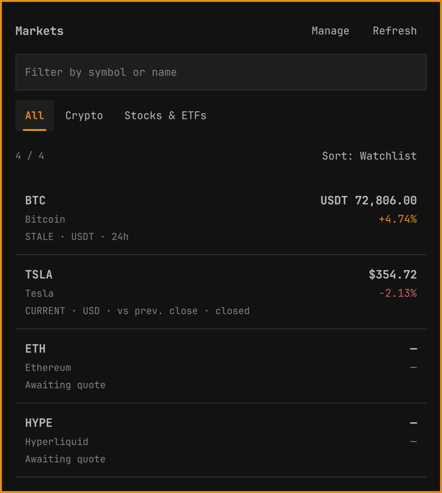
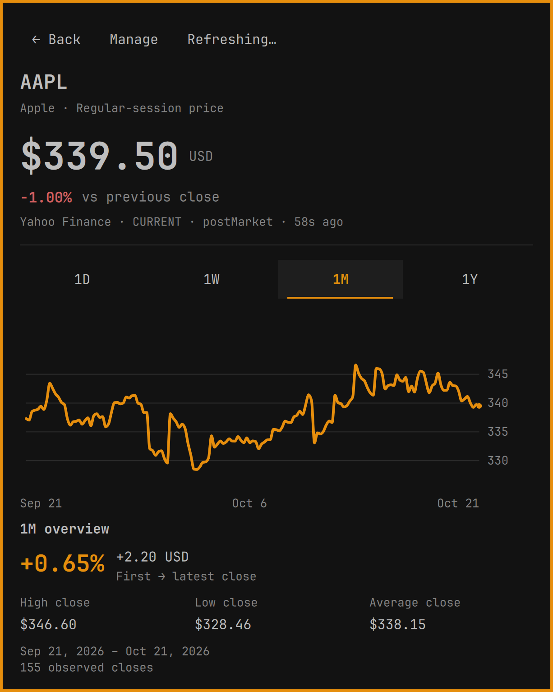
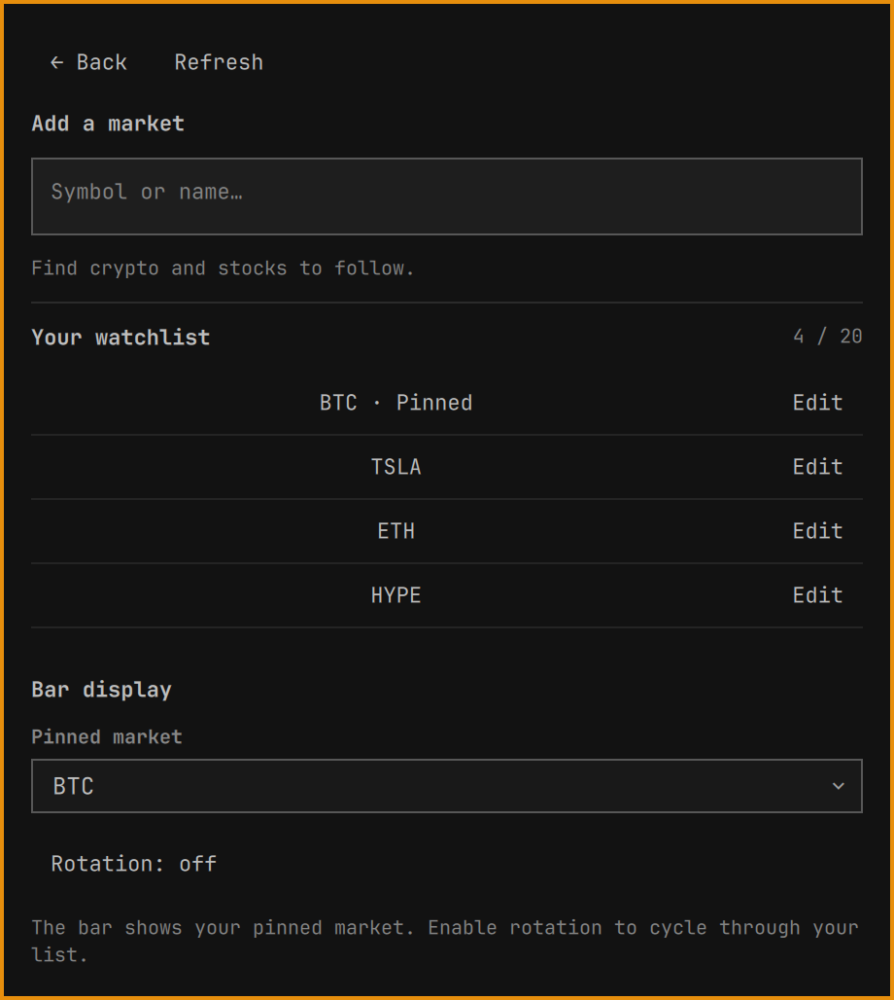
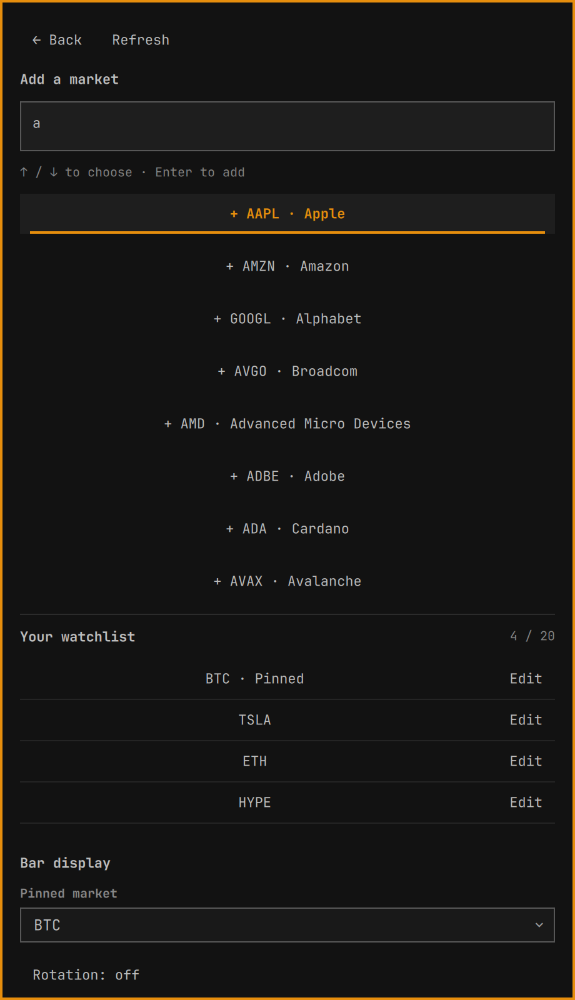

# Omarchy Market (`io.github.dpr.omarchy-market`)

A lightweight native market watchlist and ticker for **Omarchy Quattro**.
No accounts, API keys, npm packages, or background daemons.

[**Version 1.3.0**](https://github.com/DPRC137/omarchy-market/releases/tag/v1.3.0) · [Changelog](CHANGELOG.md) · [Data semantics](docs/SEMANTICS.md)

## What's new in 1.3.0

- **Direct chart access:** clicking the bar opens the displayed instrument.
  Back brings up the compact watchlist; hover keeps the ticker in place.
- **Clearer detail:** a prominent ticker and price, a smaller currency label,
  and fixed bar-ticker selection under Manage. Rotation remains optional.
- **Reliable equity 1D:** shows the latest regular session with its date across
  weekends and closures, with bounded recovery for empty provider responses.
- **Explicit market data:** retain source currency, instrument type, quote age,
  connection state and session status; stale values stay labelled.
- **Watchlist management:** keyboard search, ordering and Undo, with existing
  watchlists and preferences preserved during migration.

## Native redesign (unreleased)

The watchlist now supports local filtering, categories and view-only sorting.
Detail emphasizes price, movement and source currency, with session-aware
history, a labelled price scale and keyboard inspection. Manage groups discovery, contextual row actions,
pinning and rotation. The native header stays available while content scrolls.

## Screenshots

Real Quickshell/Quattro popup captures using saved provider fixtures. These are
reproducible UI examples, not current market prices. They use the active dark
Omarchy theme in a temporary capture process.

| Watchlist | Asset detail |
| --- | --- |
|  |  |

| Manage | Search |
| --- | --- |
|  |  |

[All captures and provenance](docs/screenshots/README.md) ·
[Redesign verification and limits](docs/NATIVE_REDESIGN.md).

## Watchlist and detail

Click the bar ticker to open that instrument’s chart directly. Back shows compact
watchlist rows. Select any row for source-labelled
prices, regular-session equity metrics or rolling 24-hour crypto metrics, native
Canvas history, and an expandable Spot/Perp comparison. Back returns to the list.
Filter the watchlist by symbol, name or category; cycle Sort to compare movement
without changing the saved order. Manage searches the local catalog and Yahoo
stocks/ETFs; arrows and Enter add results, and removed rows have Undo. Each row’s
Edit actions provide move, pin and remove controls; Alt+Up/Down reorders from Edit.
Up to 20 instruments are supported; existing watchlists migrate in place.

Headlines and history share one explicit instrument: Binance **USDT spot**,
Yahoo equities in their **reported currency**, or Hyperliquid **HYPE USDC perpetual**.
USD and USDT are distinguished; sources are never averaged or silently replaced
with perpetual prices. HYPE's headline is mark price; its candle closes are trades.
Missing data appears as `—`. Equity volume is shares, not dollars.

Connection state, quote age and session status are separate. Last-known values
stay visible with age and freshness when a feed fails. History has loading,
unavailable, stale-cache and retry states. Choose `1D / 1W / 1M / 1Y`; actual
dates, interval and source appear beneath the chart. Equity 1D shows the latest
regular session across closures; crypto 1D is 24 hours. Longer ranges use
calendar windows.
See [exact semantics](docs/SEMANTICS.md).

## Requirements

- Omarchy Quattro, Quickshell **0.3+**, Qt **6.8+**.
- Node.js **22.4+** with native WebSocket enabled (24/26 also supported).
- Public internet access to provider APIs. Yahoo's endpoints are unofficial;
  availability, limits, delays and coverage may change without notice.

Binance/Coinbase streams use child Node processes owned by the plugin; those
stop when unwatched or disabled. Hyperliquid uses HTTP polling. Stock-only
watchlists start no crypto bridges. No extra service or systemd unit is installed.

## Installation

```bash
omarchy plugin add https://github.com/DPRC137/omarchy-market.git --enable --yes
```

Manual installation:

```bash
git clone https://github.com/DPRC137/omarchy-market.git ~/.config/omarchy/plugins/io.github.dpr.omarchy-market
omarchy-shell shell rescanPlugins
omarchy plugin enable io.github.dpr.omarchy-market
```

### Upgrading to 1.3.0

```bash
omarchy plugin update io.github.dpr.omarchy-market --yes
omarchy restart shell
```

Your watchlist, order, fixed ticker, rotation preference and existing widget
settings are preserved. Restarting the shell loads the updated QML code.
Prices now retain their explicit source currency and instrument type; see the
[1.3.0 changelog](CHANGELOG.md) for the behavior changes.

Remove with `omarchy plugin remove io.github.dpr.omarchy-market`.

## Controls and settings

- Bar left-click: chart for the displayed instrument. Back opens the watchlist. Middle-click: refresh quotes and any visible
  history. Right-click: cycle and pin a bar instrument.
- **Manage → Bar ticker**: choose a stable asset. Rotation is off by default and
  can be enabled in Manage. The chart emphasizes the ticker and price, with a smaller
  currency label. The bar fits its text, and hovering keeps neighboring indicator reveals from
  shifting it. Crypto bar prices omit quote codes; tooltip and detail preserve them.
- **Tab / Shift+Tab**: move between controls and rows. **Enter / Space** activates.
- **Escape**: Back from detail/Manage, then close. **R** refreshes outside search;
  **/** opens Manage and focuses search. Search supports Up/Down and Enter.
- Hover or focus the chart and use Left/Right, Home/End for actual candle time
  and price. Chart times use your local timezone; equity spacing omits closed
  periods. The selected window has its own change and high/low/average close
  overview. Expand the latest-session/24-hour snapshot for current daily volume.

Stale or missing quotes trigger automatic recovery, with attempts limited to
once per provider every 15 seconds. Refresh replaces outstanding quote requests
and reconnects streams, with a 30-second reconnect cooldown. The button shows
“Refreshing…” while requests are pending. Provider outages can still delay new data;
the last received values stay labelled stale until an update succeeds.

Existing `shell.json` widget settings remain supported:

```json
{ "id": "io.github.dpr.omarchy-market", "multiAsset": false, "speed": 4000 }
```

`multiAsset` shows up to two instruments; `speed` controls optional rotation.
Watchlist order, discovered equity metadata, pin and rotation use the original
Qt Settings category `io.github.dpr.omarchy-market`; no shell.json rewrite is
required. [Architecture and persistence](docs/ARCHITECTURE.md).

## Development

```bash
bash tests/run_tests.sh       # portable production-module checks, also run in CI
bash tests/lint_qml.sh        # Qt/Quattro imports required
node tests/run_native.js      # real QML XHR, deadlines, settings restart, cleanup
node tests/run_ui.js          # real Wayland popup, pointer and keyboard checks
node tests/run_ui.js ticker   # compact bar, hover, direct asset chart and rotation
node tests/run_ui.js chart    # session axis, curve geometry and inspection
node tests/run_ui.js window   # timeframe stats and stale/missing/single states
node tests/capture_ui.js      # native fixture screenshots; no live requests
node tests/run_ui.js equity   # optional live Yahoo session-chart regression
./scripts/live-test.sh        # optional external WebSocket connectivity
```

Native tests use temporary settings and leave the installed shell intact.
See [testing and limitations](docs/TESTING.md). Node tests alone do not establish
that the native UI works.

Changes reach the protected `master` branch through checked pull requests.
See [maintainer workflow](docs/MAINTAINING.md).
