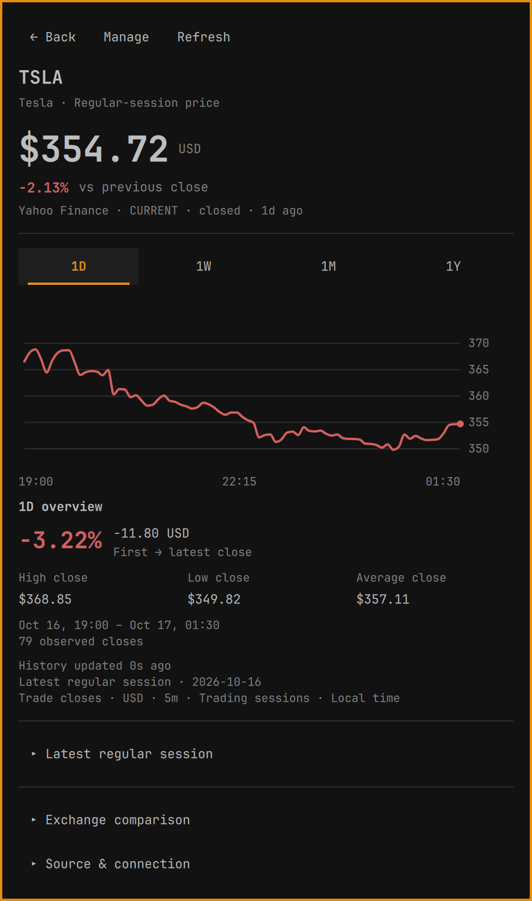
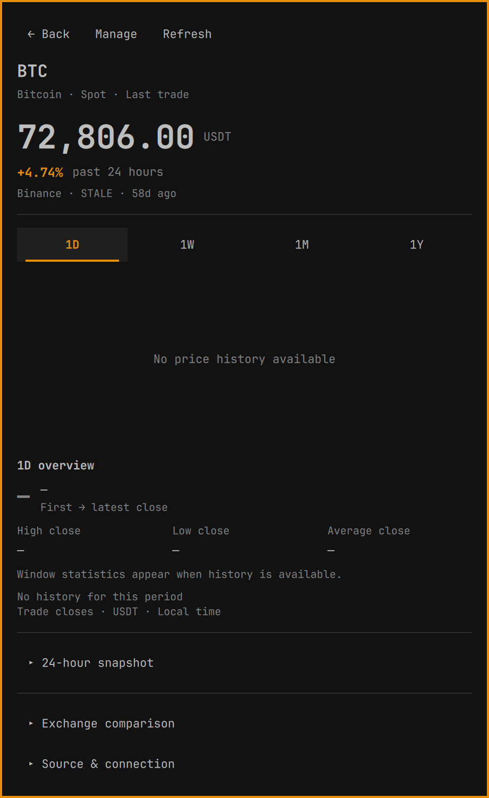
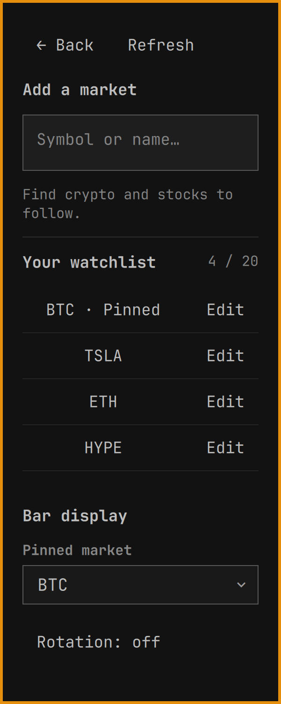
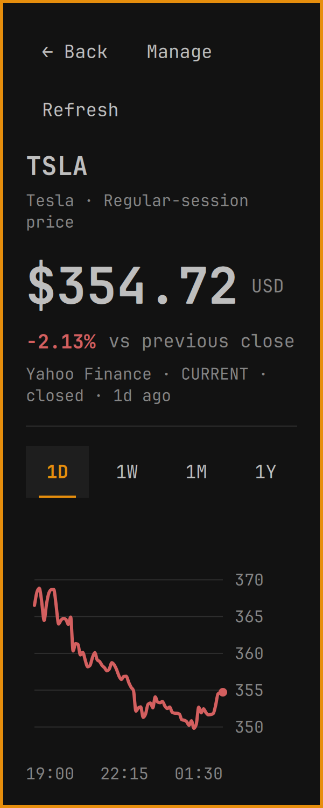
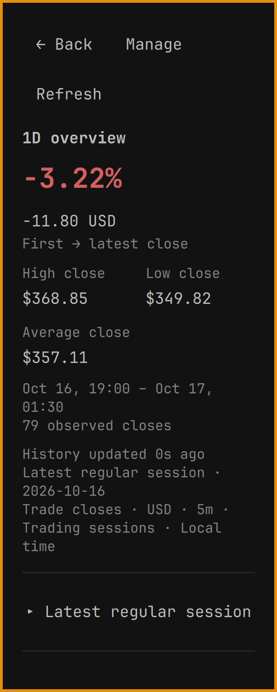
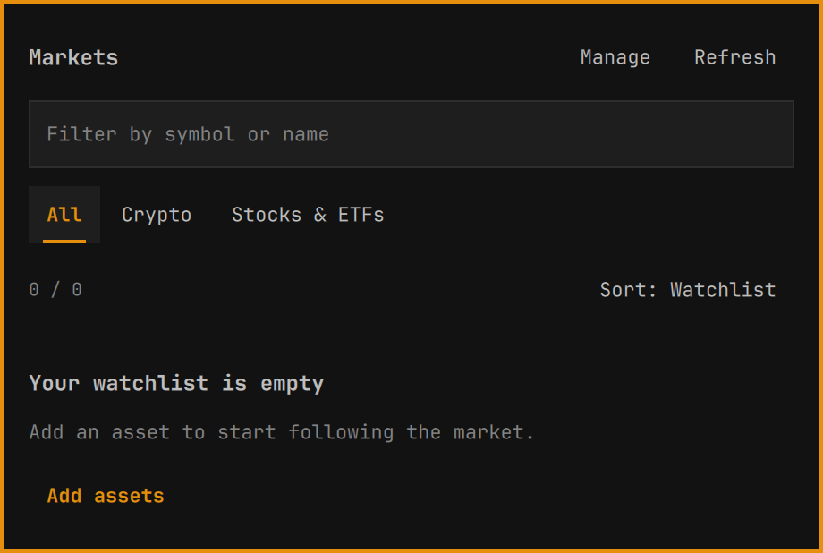
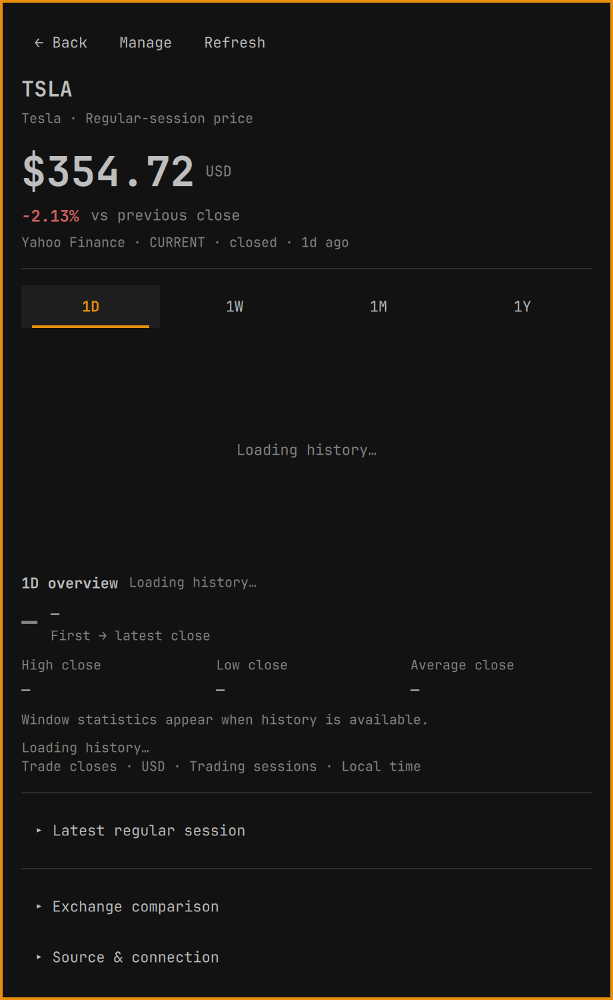
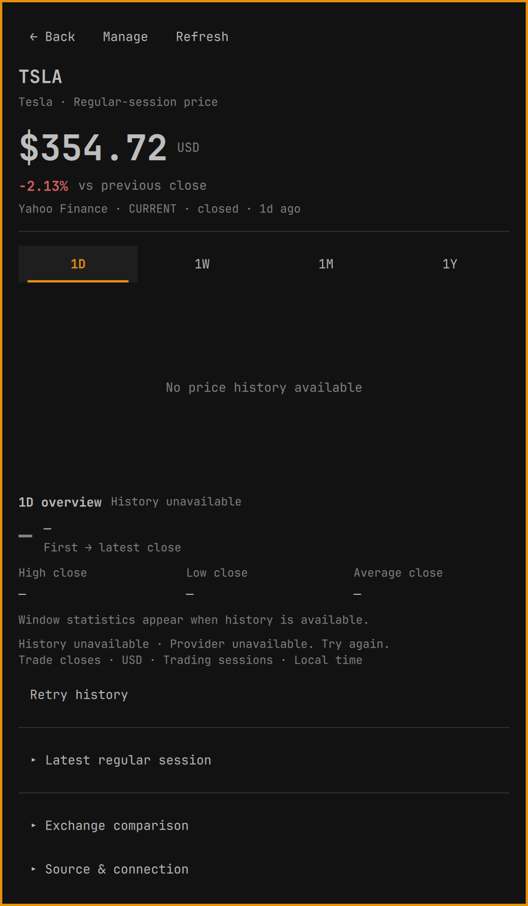
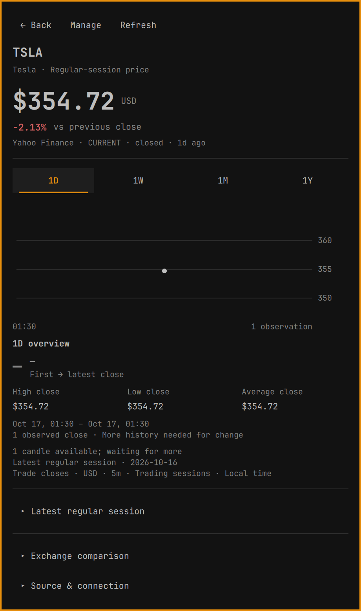

# Omarchy Market 1.4.0 gallery

Crypto, stocks and ETFs in a native Omarchy desktop plugin. Open the instrument
shown in the bar, explore its history, compare the selected date window, or
organize a watchlist without accounts or API keys.

## Explanatory marketplace preview

The root `preview.png` is generated promotional artwork composed from the two
original chart captures below. Its surrounding text explains the app; it is not
an additional application screen. The originals here preserve the actual UI.

## Equity and crypto charts

Choose 1D, 1W, 1M or 1Y. The overview follows that selection with price change,
high/low/average observed close, coverage and sample count. Equity spacing omits
closed periods. Daily quote change remains separate from the selected-window
comparison, and the daily/session snapshot can be expanded below the chart.

| AAPL · one month | BTC · one week |
| --- | --- |
|  |  |

| Latest equity session | Crypto detail with unavailable history |
| --- | --- |
|  |  |

## Watchlist and management

Filter by symbol or name, choose a category, and sort the view without changing
saved order. Manage adds search and contextual editing, with pinning and optional
rotation for the bar ticker. Removals support Undo.

| Watchlist | Manage |
| --- | --- |
|  |  |

## Narrow windows and enlarged text

These captures use a 300px card and 18px base text. Navigation wraps and content
scrolls; the final image shows the selected-window summary after scrolling.

| Manage | Detail | Selected-window overview |
| --- | --- | --- |
|  |  |  |

## Explicit data states

Empty watchlists, loading history, provider errors and a single observed close
remain usable states. A single close has no invented return; unavailable
statistics use an em dash.

| Empty watchlist | Loading history |
| --- | --- |
|  |  |

| History unavailable | One observed close |
| --- | --- |
|  |  |

## Capture provenance

All 14 originals were rendered on 2026-10-21 (Asia/Kolkata), from merged native
UI commit `11fdf542f73c134111d334ab744e80be0b0cf4e1`, using Quickshell/Quattro
on Wayland and the active dark theme. They include the actual card background
and border, with no surrounding desktop, accounts or personal preferences.

- `aapl-month.png`: live Yahoo Finance AAPL, 1M, 155 hourly closes.
- `crypto-week.png`: live Binance BTC/USDT, 1W, 168 hourly closes.
- The other 12 images use `tests/capture_ui.js` and saved provider fixtures:
  Yahoo TSLA's 2026-10-16 regular session (79 closes), a stale Binance BTC quote,
  and explicitly unavailable ETH/HYPE quotes. They are deterministic examples.
- `preview.png` was generated using imagegen with the original AAPL and BTC
  captures as compositing inputs. It is promotional artwork, not an unedited
  screenshot; source originals are linked above.

Market prices, timestamps, ages and provider states are observations at capture
time, not ongoing quotes or availability guarantees. Temporary capture hosts
preserved the installed watchlist and settings. See the
[test scope and limitations](../../TESTING.md) and [data semantics](../../SEMANTICS.md).
