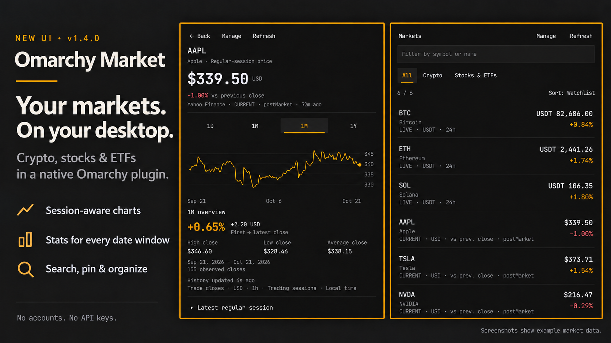
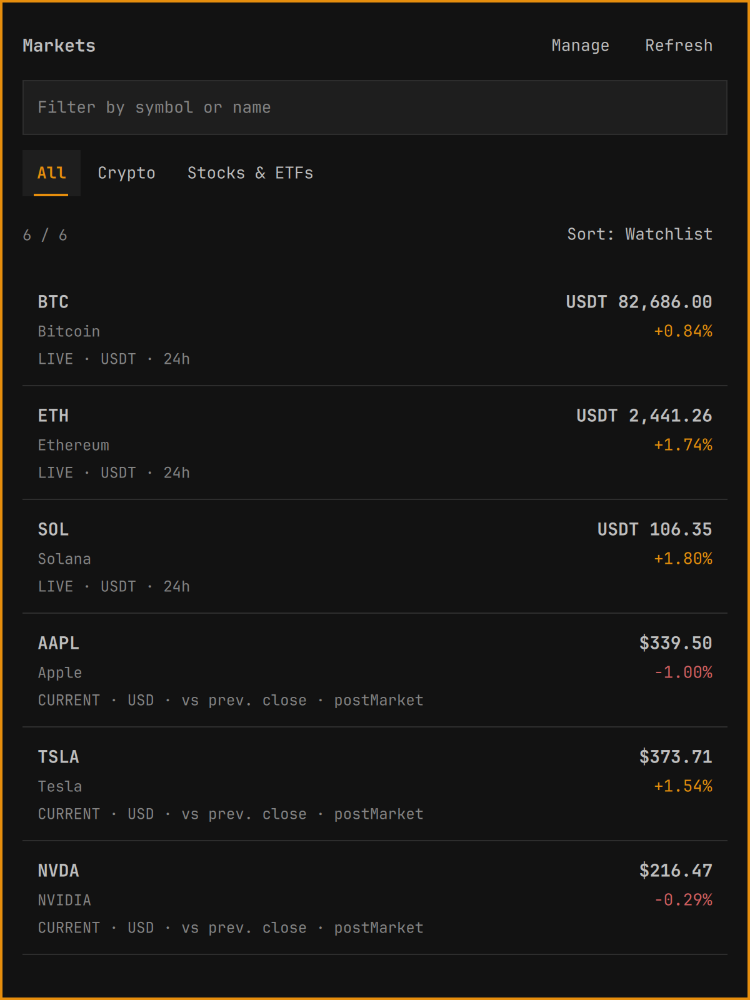
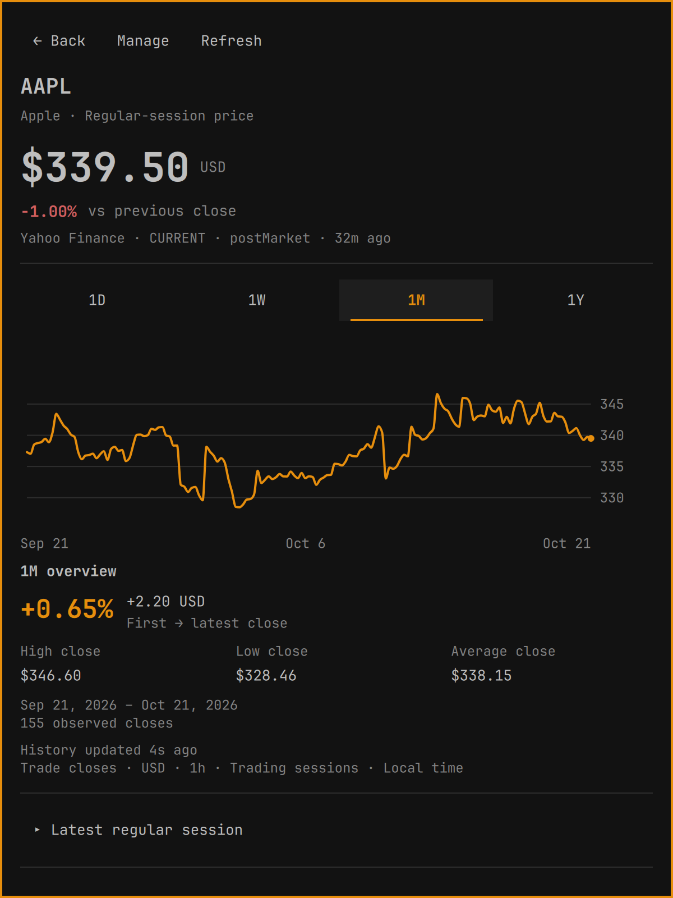
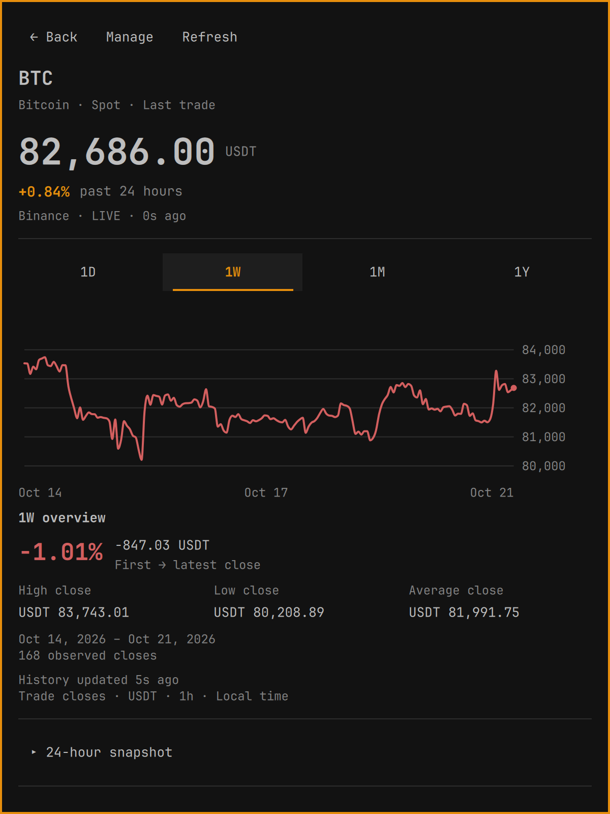
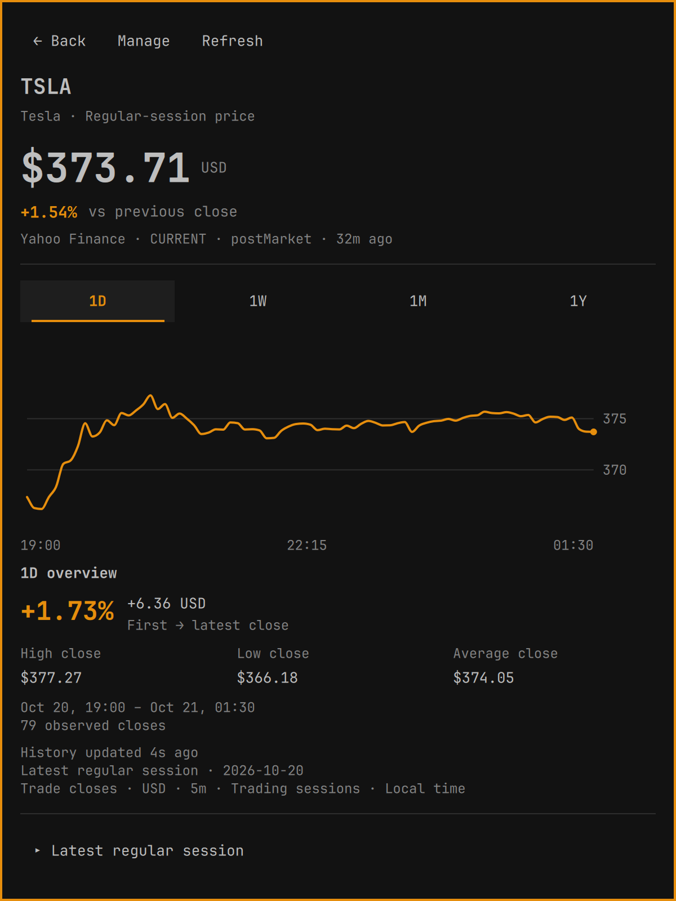
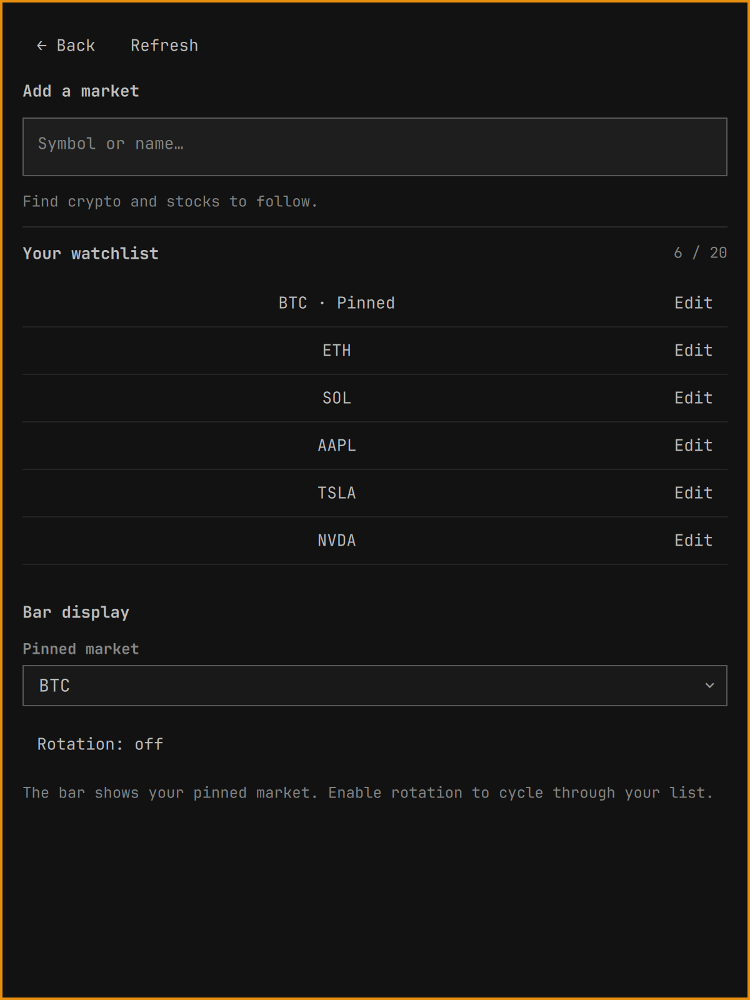
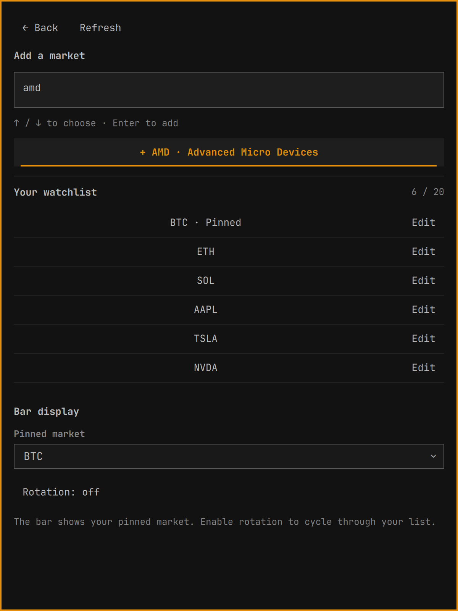
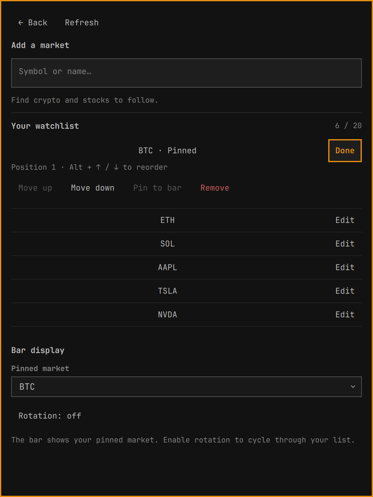

# Omarchy Market 1.4.0 gallery

Crypto, stocks and ETFs in a native Omarchy desktop plugin. Open the instrument
shown in the bar, explore its history, compare a date window, or organize a
watchlist without accounts or API keys.

All seven original screenshots show fully loaded live screens at the same
**600×800 native window size** (1200×1600 PNGs on the capture display), with the
same font size and dark theme. Refresh and search activity finished before capture.

## Explanatory marketplace preview

The root `preview.png` is generated promotional artwork composed from the
original chart and watchlist captures below. Its surrounding text explains the app; it is not
an additional application screen. The originals here preserve the actual UI.

## Watchlist and equity detail

Filter by symbol or name, choose a category, and sort the view without changing
saved order. Choose 1D, 1W, 1M or 1Y to see history and statistics for that window.

| Watchlist | AAPL · one month |
| --- | --- |
|  |  |

## Crypto and regular-session history

The overview follows the selected dates with price change, high/low/average
observed close, actual coverage and sample count. Equity spacing omits closed
periods. Daily quote change remains separate from the selected-window comparison.

| BTC · one week | TSLA · latest regular session |
| --- | --- |
|  |  |

## Discovery and bar settings

Search for instruments, edit the watchlist, and choose a pinned bar ticker or
optional rotation. All quotes are loaded before these screens are captured too.

| Manage | Search |
| --- | --- |
|  |  |

## Contextual editing

Move, pin or remove a market from its Edit actions. Keyboard reordering uses
Alt+Up/Down, and removals support Undo.

## Capture provenance

Captured on 2026-10-21 (Asia/Kolkata), using production Quickshell/Quattro
components and providers on Wayland. The gallery uses a temporary host at one
fixed 600×800 card size and 14px base font, with no resizing or retouching.
Direct compositor captures show the visible window. All cards include
the actual background and border; no surrounding desktop,
accounts or personal settings are included.

- Example watchlist: BTC, ETH, SOL, AAPL, TSLA and NVDA. Every quote is loaded
  and marked live/current by the production freshness rules.
- AAPL 1M: live Yahoo Finance, 155 hourly closes.
- BTC 1W: live Binance BTC/USDT, 168 hourly closes.
- TSLA 1D: live Yahoo Finance, 79 five-minute closes from the latest regular session.
- Each image has its own fresh native host. Capture waits for ready history,
  completed search and provider refresh work, then a further two-second settled
  interval. Dimensions are checked across the complete set.
- `preview.png` uses imagegen to create explanatory artwork from these original
  AAPL and watchlist captures. It is a promotional composition, not an unedited screenshot.

Market prices, timestamps, ages and provider states are observations at capture
time, not ongoing quotes or availability guarantees. Temporary hosts preserve
the installed watchlist and settings. Reproduce with `node tests/capture_gallery.js`;
set `MARKET_CAPTURE_DIR` to choose the output location. See
[test scope and limitations](../../TESTING.md) and [data semantics](../../SEMANTICS.md).
